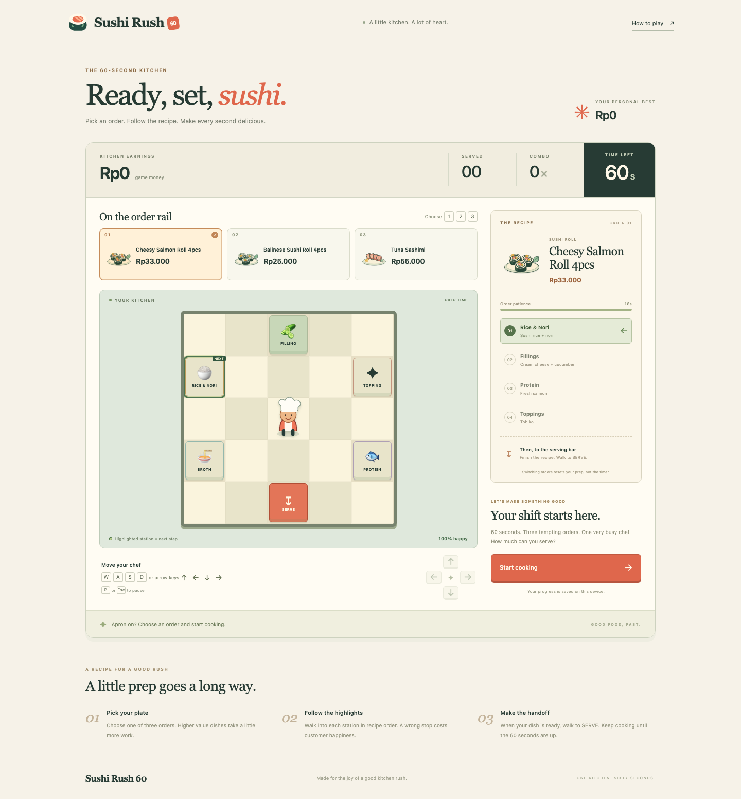

# Sushi Rush 60

A standalone, single-page cooking game. Choose an order, collect ingredients in recipe order, and reach the serving bar before the clock runs out. This personal project base uses a local game engine, original SVG food illustrations, and browser storage.



## Run on an isolated desktop

Requires **Node.js 22 or newer** and a browser. No package installation, internet access, GPU, sound, Docker, account, database, API key, or production service is needed.

```sh
cd sushi-rush-alignerr
npm start
```

Open **http://127.0.0.1:3000** in the desktop browser. Keep the terminal running. Stop it with Ctrl+C. The server listens on loopback by default.

To use another port:

```sh
npm start -- --port 3001
```

`npm run dev` runs the same server. Source files are served directly; refresh the browser after editing them. Do not open `index.html` with a `file://` URL, because browsers restrict JavaScript module loading there.

## Play

- Start a 60-second round. Pick one of three order cards with the mouse or keys **1**, **2**, and **3**.
- Move with **WASD**, the **arrow keys**, or the on-screen direction buttons.
- Enter each required station in the order shown by the recipe. Ingredients are collected when you move onto the station tile.
- After the final ingredient, move onto the **serving bar** to deliver the order. Completing the recipe alone does not deliver it.
- Changing orders resets the current recipe's progress; it does not restart the order deadline.
- Pause and resume a round locally. An unfinished round can be resumed from this browser's saved state. Clearing browser storage removes local progress and records.
- The result shows the round's earnings, completed orders, and best combo. Prices are fictional game values; records are local to this browser.

The kitchen is rendered with ordinary HTML and CSS. Gameplay does not depend on WebGL or audio.

## Check and build

```sh
npm test
npm run build
npm run preview
```

Tests use Node's built-in test runner. The build copies the browser files into `dist/`; it does not download or compile dependencies. Preview serves that output at the same loopback address. Stop an existing server before starting another on the same port.

## Prepare an Alignerr upload

The [provided session requirements](https://docs.google.com/document/d/1Jw-iFUt6voVCT2pfL8avH39dGE8FeF6XEpFZJL_mpZM/edit) describe an isolated Linux desktop with Node 22, a browser, no internet, no GPU, and no sound. This repository is designed for those limits.

After committing the source and setting the repository's credential-free GitHub origin, run:

```sh
npm run package
```

This creates `sushi-rush-alignerr-upload.tar.gz` next to the repository. It contains the committed source **and its `.git` folder**, with a portable Git configuration. Ignored local files, dependencies, and build output are excluded. The archive name uses only letters, digits, and dashes before `.tar.gz`.

Before the first session message, upload that archive through the workspace's **Upload** control, supply this repository's GitHub main-page URL as its source, choose **Extract**, and save. The extracted project should appear under `/home/model/Uploads/sushi-rush-alignerr`. In its terminal, run:

```sh
cd /home/model/Uploads/sushi-rush-alignerr
npm start
```

Open `http://127.0.0.1:3000` in the isolated desktop's browser. Do not sign in to personal or production accounts there.

The project must be approved by the project contact before its first session. The required personal report and project explanation should be written by you in your own words. Tasking, prompts, assistant interactions, and submissions within that program must be in English. This repository supplies a runnable starting codebase, not those personal statements or project approval.

## Source map

```text
index.html              Single-page interface
src/app.js              Browser interaction, clock, local persistence
src/styles.css          Responsive kitchen and interface
src/game/               Deterministic game engine, recipes, balance
public/menu/            Local food images
scripts/server.mjs      Dependency-free local HTTP server
scripts/build.mjs       Static output packaging
scripts/package.mjs     Clean repository upload archive, including .git
tests/                  Node test suites
docs/VERIFICATION.md    Isolated-desktop verification procedure
```

This copy has its own Git history and does not need the original site's accounts, branding, deployment configuration, or backend.
