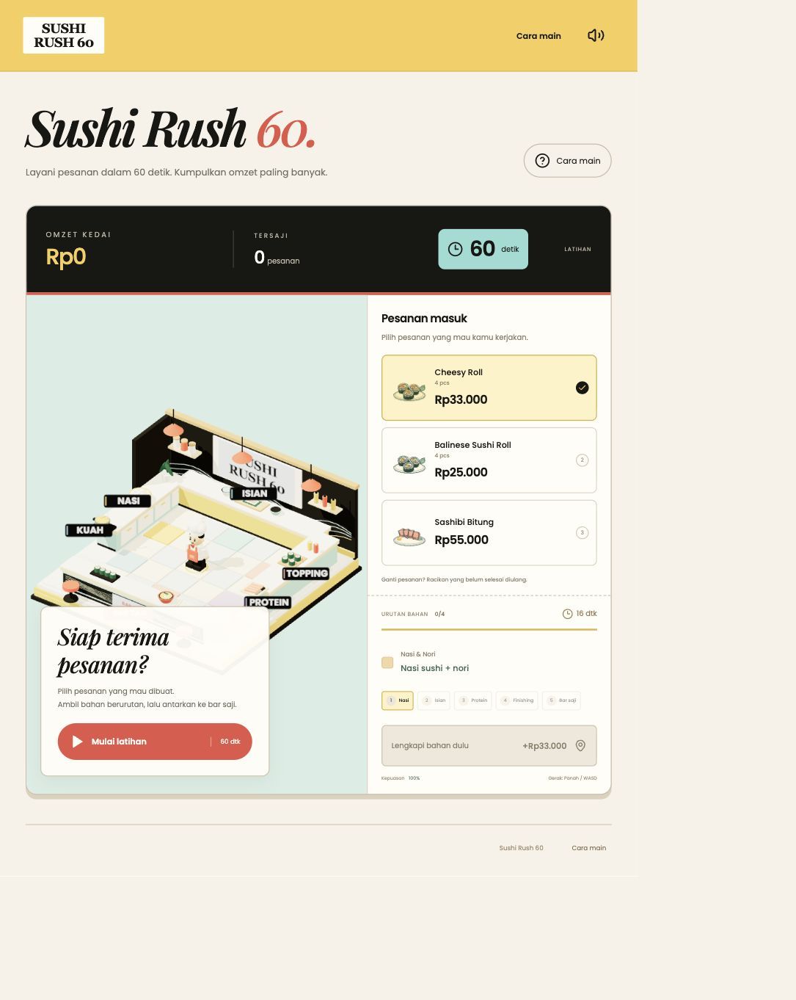

# Sushi Rush 60

A standalone copy of the original single-page Sushi Rush 60 game. It preserves the original 3D kitchen, chef, camera, layout, drag controls, music, and cooking rules. Branding and connected account/competition services are removed.



## Run on an isolated desktop

Requires **Node.js 22 or newer** and a browser. Running and rebuilding need no package installation or internet access. No account, database, API key, Docker, or production service is needed. The original 3D view uses WebGL; a secondary playable view appears only when the browser cannot provide it. Sound is optional.

```sh
cd sushi-rush-alignerr
npm start
```

Open **http://127.0.0.1:3000** in the desktop browser. Keep the terminal running. Stop it with Ctrl+C. The server listens on loopback by default.

To use another port:

```sh
npm start -- --port 3001
```

`npm run dev` runs the same server. After editing TypeScript or TSX source, run `npm run build` and refresh the browser. CSS changes need only a refresh. Open the localhost URL: browsers restrict JavaScript module loading when `index.html` is opened as a `file://` URL.

## Play

- Start a 60-second round. Pick one of three order cards with the mouse or keys **1**, **2**, and **3**.
- Move with **WASD**, the **arrow keys**, or the original hold-and-drag controls. The secondary view also has direction buttons.
- Enter each required station in the order shown by the recipe. Ingredients are collected when you move onto the station tile.
- After the final ingredient, move onto the **serving bar** to deliver the order. Completing the recipe alone does not deliver it.
- Changing orders resets the current recipe's progress; it does not restart the order deadline.
- Pause and resume a round locally. An unfinished round can be resumed from this browser's saved state. Clearing browser storage removes local progress and records.
- The result shows the round's earnings, completed orders, and best combo. Prices are game values; saved practice is local to this browser.

The original Three.js kitchen is the default. The secondary view is a compatibility fallback, without changing the game engine or its station positions. Audio is not required to complete a round.

## Check and build

```sh
npm test
npm run build
npm run preview
```

Tests use Node's built-in test runner. The build transpiles the original TypeScript/TSX source into `browser/` using a bundled, pure-JavaScript TypeScript compiler. React, Three.js, icons, and fonts are local. There are no platform-specific build binaries. A runnable `browser/` is included in Git and the upload archive, and the build also creates `dist/` for preview. Stop an existing server before starting another on the same port.

## Prepare an Alignerr upload

The [provided session requirements](https://docs.google.com/document/d/1Jw-iFUt6voVCT2pfL8avH39dGE8FeF6XEpFZJL_mpZM/edit) describe an isolated Linux desktop with Node 22, a browser, no internet, no GPU, and no sound. This repository is designed for those limits.

Download the ready-to-upload `sushi-rush-alignerr-upload.zip` from the [latest release](https://github.com/andrianaria/sushi-rush-alignerr/releases/latest). A `.tar.gz` version is also available. Both upload archives include `.git`; GitHub's automatic **Download ZIP** and source archives do not. To create fresh uploads after changing the code, follow the steps below.

After committing the source and setting the repository's credential-free GitHub origin, run:

```sh
npm run package
```

This creates `sushi-rush-alignerr-upload.zip` and `sushi-rush-alignerr-upload.tar.gz` next to the repository. Each contains the committed source, portable compiler, local browser vendors, ready-to-run browser files, **and a fresh `.git` folder**, with an anonymous snapshot commit and a portable GitHub origin. The snapshot has its own commit ID; it does not carry prior history or author identity. Published GitHub history remains unchanged. Ignored local files, `node_modules`, `dist`, and local Git configuration are excluded. The helper scans raw files and decoded Git objects for addresses and removed branding. It needs `git`, `tar`, and `zip` only for packaging.

Before the first session message, upload that archive through the workspace's **Upload** control, supply this repository's GitHub main-page URL as its source, choose **Extract**, and save. The extracted project should appear under `/home/model/Uploads/sushi-rush-alignerr`. In its terminal, run:

```sh
cd /home/model/Uploads/sushi-rush-alignerr
npm start
```

Open `http://127.0.0.1:3000` in the isolated desktop's browser. Do not sign in to personal or production accounts there.

The project must be approved by the project contact before its first session. The required personal report and project explanation should be written by you in your own words. Tasking, prompts, assistant interactions, and submissions within that program must be in English. This repository supplies a runnable starting codebase, not those personal statements or project approval.

## Source map

```text
index.html              One browser page and local launch instructions
src/App.tsx             Original practice flow, layout, controls, and audio
src/components/         Original 3D scene, drag controller, fallback, and tutorial
src/styles.css          Original responsive interface styles
src/game/               Deterministic game engine, recipes, balance, and tests
src/lib/                Local practice storage, menu assets, and original audio
browser/                Ready-to-run browser modules
vendor/                 Portable compiler, browser libraries, and licenses
public/                 Local illustrations, neutral logo, fonts, and licenses
scripts/server.mjs      Dependency-free local HTTP server
scripts/build.mjs       Offline source compilation and static output
scripts/package.mjs     Clean repository upload archive, including .git
tests/                  Node test suites
docs/VERIFICATION.md    Isolated-desktop verification procedure
```

This copy has its own Git history and does not need the original site's accounts, branding, deployment configuration, or backend.
